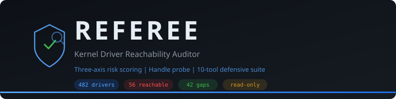

<p align="center">
  
</p>

<h1 align="center">REFEREE</h1>
<p align="center">
  <b>Systematic Reachability Analysis of Windows Kernel Driver Attack Surface</b>
</p>

<p align="center">
  <a href="#quick-start">Quick Start</a> &bull;
  <a href="#architecture">Architecture</a> &bull;
  <a href="#tools">Tools</a> &bull;
  <a href="#results">Results</a> &bull;
  <a href="#detections">Detections</a> &bull;
  <a href="docs/CFP_ABSTRACT.md">CFP Abstract</a> &bull;
  <a href="CONTRIBUTING.md">Contributing</a>
</p>

<p align="center">
  
  
  
  
  
  
</p>

---

## The Problem

Every gamer on the planet voluntarily installs a signed, Microsoft-trusted ring-0 kernel driver. Every AV and EDR whitelists it on sight. The security industry's only question has been: *"Is this one on the naughty list?"*

We asked a different question: **Who can actually open a handle to each of these drivers, and what god-mode primitives does that hand them?**

The answer was worse than we expected.

## The Key Finding

| Method | Reachable Drivers Found | Coverage |
|--------|------------------------|----------|
| ACL analysis (what everyone uses) | 24 | 5.4% classified |
| **REFEREE handle probe** | **56** | **12.9% classified** |
| **Increase** | **+133%** | More than half the attack surface was invisible |

42 of those 56 reachable, high-capability drivers are **absent from loldrivers.io** — the only catalog most defenders use. The catalog covers 1 of the 56. REFEREE covers the other 55.

Five drivers are reachable from a **sandboxed process** (LOW tier) — including Riot Vanguard (`vgk.sys`), a boot-start anti-cheat with process-manipulation and callback-removal imports, openable from inside an AppContainer.

## Architecture

REFEREE uses a **three-axis risk scoring** methodology that moves driver assessment from catalog lookups to ground-truth reachability:

```
                    ┌─────────────────────────────────────────────┐
                    │              REFEREE Pipeline                │
                    └─────────────────────────────────────────────┘
                                       │
                    ┌──────────────────┼──────────────────┐
                    ▼                  ▼                  ▼
            ┌──────────────┐  ┌──────────────┐  ┌──────────────┐
            │  AXIS 1:     │  │  AXIS 2:     │  │  AXIS 3:     │
            │  Capability  │  │  Reachability │  │  Known Vuln  │
            ├──────────────┤  ├──────────────┤  ├──────────────┤
            │ PE imports:  │  │ 5 discovery  │  │ loldrivers   │
            │ • MmMapIo    │  │ sources:     │  │ cross-ref:   │
            │ • ZwOpenProc │  │ • DeviceMap  │  │ • SHA256     │
            │ • ObRegister │  │ • Interfaces │  │   hash match │
            │   Callbacks  │  │ • IoCreate   │  │ • Name-only  │
            │ • PsSetCreate│  │ • Known maps │  │   detection  │
            │   ProcessNot │  │ • Svc params │  │ • 702-entry  │
            │              │  │              │  │   database   │
            │ 3 categories │  │ CreateFileW  │  │              │
            │ scored 0-30  │  │ handle probe │  │ Scored 0-40  │
            └──────┬───────┘  │ (zero-access)│  └──────┬───────┘
                   │          │              │         │
                   │          │ Integrity    │         │
                   │          │ tier:        │         │
                   │          │ LOW/MEDIUM   │         │
                   │          │              │         │
                   │          │ Scored 0-30  │         │
                   │          └──────┬───────┘         │
                   │                 │                 │
                   └─────────┬───────┘─────────┬──────┘
                             ▼                 ▼
                    ┌─────────────────────────────────┐
                    │   Composite Risk Score (0-100)   │
                    │   12-category driver taxonomy    │
                    └────────────────┬────────────────┘
                                    │
           ┌────────────┬───────────┼───────────┬────────────┐
           ▼            ▼           ▼           ▼            ▼
     ┌──────────┐ ┌──────────┐ ┌────────┐ ┌────────┐ ┌──────────┐
     │ JSON     │ │ Markdown │ │ WDAC   │ │ Sigma  │ │Dashboard │
     │ Report   │ │ Report   │ │ Policy │ │ Rules  │ │  (HTML)  │
     └──────────┘ └──────────┘ └────────┘ └────────┘ └──────────┘
```

### Handle Probe (the core innovation)

Previous tools check only the service registry Security descriptor — which most drivers don't set, leaving ~95% as "Unknown." REFEREE discovers device paths from **five sources**, then **ground-truths** each with a zero-access `CreateFileW` handle probe:

```
 Device Name Discovery                    Handle Probe
 ─────────────────────                    ────────────
 1. Registry DeviceMap            ──┐
 2. Device interface classes      ──┤     CreateFileW(
 3. IoCreateDevice conventions    ──┼──▶    path,
 4. 70+ known driver→device maps  ──┤       FILE_READ_ATTRIBUTES,
 5. Service Parameters keys       ──┘       FILE_SHARE_READ,
                                            OPEN_EXISTING
                                          )
                                            │
                                     ┌──────┴──────┐
                                     │             │
                                  HANDLE        ACCESS_DENIED
                                  opened        returned
                                     │             │
                                     ▼             ▼
                              USER_REACHABLE  RESTRICTED
                              (classify tier)
```

**Read-only. No IOCTLs. No driver loads. Ever.**

## Quick Start

### Requirements
- Windows 10/11
- PowerShell 5.1+ (built-in) or PowerShell 7+
- Administrator privileges (for ACL reads and PE inspection)

### Run the deep scan

```powershell
# Clone and scan
git clone https://github.com/sapnavmewundi/REFEREE.git
cd REFEREE

# Run the three-axis deep scanner
powershell -ExecutionPolicy Bypass -File auditor\Referee-DeepScan.ps1
```

Output: `auditor/out/deepscan-<timestamp>.json` + Markdown summary.

### View results in the dashboard

```powershell
# Start a local HTTP server to serve the dashboard
cd auditor
python -m http.server 8080
# Open: http://localhost:8080/dashboard.html?data=out/deepscan-<timestamp>.json
```

### Run the full suite

```powershell
# Gap analysis — what catalogs miss
powershell -File auditor\Referee-Gap.ps1

# Before/after delta — install a game, measure what it added
powershell -File auditor\Referee-Delta.ps1 -Before out\scan-before.json -After out\scan-after.json

# Fleet scan across multiple hosts
powershell -File auditor\Referee-Fleet.ps1 -Hosts srv01,srv02,srv03 -Credential (Get-Credential)

# Real-time monitoring
powershell -File auditor\Referee-Monitor.ps1 -Continuous

# Generate WDAC block policy
powershell -File auditor\Referee-WDACValidate.ps1 -Report out\deepscan-latest.json
```

## Tools

REFEREE ships as a **10-tool defensive suite** — every finding comes with a deployable countermeasure.

| # | Tool | Script | Purpose |
|---|------|--------|---------|
| 1 | **DeepScan** | `Referee-DeepScan.ps1` | Three-axis scanner with handle probe — the headline tool |
| 2 | **Gap Analysis** | `Referee-Gap.ps1` | Capability x catalog matrix proving what catalogs miss |
| 3 | **Delta** | `Referee-Delta.ps1` | Before/after install attack-surface diff |
| 4 | **Fleet Runner** | `Referee-Fleet.ps1` | Multi-host PSRemoting scan + config-drift detection |
| 5 | **DriverDiff** | `Referee-DriverDiff.ps1` | Cross-host/longitudinal binary comparison |
| 6 | **Monitor** | `Referee-Monitor.ps1` | Real-time Sysmon/EventLog driver-load watcher |
| 7 | **WDAC Validate** | `Referee-WDACValidate.ps1` | Hash-based block policy + audit-mode staging |
| 8 | **Dashboard** | `dashboard.html` | Interactive dark-themed browser dashboard |
| 9 | **Sigma + YARA** | `detections/` | 4 Sigma rules + 4 YARA rules for driver abuse |
| 10 | **Research Pipeline** | `research/analyze.py` | Deterministic chart/table generation from JSON |

Supporting tools: `Referee-Audit.ps1` (signature scanner), `Referee-CapScan.ps1` (PE import scanner), `Referee-LOLCheck.ps1` (loldrivers.io cross-ref), `Generate-Report.ps1` (HTML report generator).

## Results

All results from a **real Windows 11 workstation** (build 26300) — no synthetic data, no lab setups.

### Headline numbers

| Metric | Value |
|--------|-------|
| Total kernel drivers scanned | 482 |
| User-reachable (handle probe + ACL) | **56** |
| LOW tier (sandbox-reachable) | 5 |
| MEDIUM tier (standard-user) | 51 |
| CRITICAL risk | 1 (`ipt.sys`, score 70) |
| HIGH risk | 44 |
| Gap drivers (uncatalogued) | **42** |
| WDAC block rules generated | 2 |

### Notable reachable drivers (discovered by handle probe)

| Driver | Risk | Tier | What it is |
|--------|------|------|------------|
| `tcpip.sys` | HIGH (62) | MEDIUM | TCP/IP stack |
| `ntfs.sys` | HIGH (57) | MEDIUM | NTFS filesystem |
| `fltmgr.sys` | HIGH (57) | MEDIUM | Filesystem filter manager |
| `ndis.sys` | HIGH (57) | MEDIUM | Network driver interface |
| `vgk.sys` | HIGH (65) | LOW | Riot Vanguard anti-cheat |
| `ipt.sys` | CRIT (70) | LOW | Intel Platform Telemetry |
| `clfs.sys` | HIGH | LOW | Common Log File System |
| `http.sys` | HIGH | MEDIUM | HTTP protocol stack |

### Gap analysis

```
         Catalogued (loldrivers.io)    Not catalogued
        ┌─────────────────────────┬─────────────────────────┐
        │                         │                         │
  User  │   1 driver              │   42 drivers            │
  reach │   (known overlap)       │   (REFEREE's unique     │
  -able │                         │    value — invisible     │
        │                         │    to catalog triage)    │
        ├─────────────────────────┼─────────────────────────┤
        │                         │                         │
  Admin │   4 drivers             │   —                     │
  only  │   (catalog over-triage: │                         │
        │    wastes analyst time)  │                         │
        └─────────────────────────┴─────────────────────────┘
```

## Detections

### Sigma Rules (`detections/ac-driver-abuse.yml`)

| Rule ID | Detection | Event Source |
|---------|-----------|-------------|
| ref-001 | AC driver service registration outside game install | System EID 7045 |
| ref-002 | Non-game process accessing AC driver device | Security EID 4663 |
| ref-003 | Suspicious AC driver load from non-game path | Sysmon EID 6 |
| ref-004 | ETW trace session modified by non-system process | Security EID 12/14 |

### YARA Rules (`detections/ac-driver-imports.yar`)

| Rule | Target |
|------|--------|
| `HighRisk_KernelDriver_MemoryAccess` | Memory-access API imports in PE |
| `HighRisk_KernelDriver_ProcessManip` | Cross-process manipulation APIs |
| `HighRisk_KernelDriver_CallbackRemoval` | Callback removal primitives |
| `KnownAbuse_AntiCheat_mhyprot` | mhyprot driver family signatures |

### EDR Simulator (`lab/EDR-Simulator.ps1`)

Generates 8 synthetic events (JSON + XML) for Sigma rule validation: 6 should trigger, 2 baselines should not.

## Project Structure

```
REFEREE/
├── auditor/                    # Core scanning and analysis tools
│   ├── Referee-DeepScan.ps1    #   Three-axis deep scanner (headline tool)
│   ├── Referee-Gap.ps1         #   Capability x catalog gap analysis
│   ├── Referee-Delta.ps1       #   Before/after attack-surface diff
│   ├── Referee-Fleet.ps1       #   Multi-host PSRemoting runner
│   ├── Referee-DriverDiff.ps1  #   Longitudinal / cross-host diff
│   ├── Referee-Monitor.ps1     #   Real-time driver-load watcher
│   ├── Referee-WDACValidate.ps1#   WDAC policy builder + validator
│   ├── Referee-Audit.ps1       #   Signature-based AC scanner
│   ├── Referee-CapScan.ps1     #   PE import capability scanner
│   ├── Referee-LOLCheck.ps1    #   loldrivers.io cross-reference
│   ├── Generate-Report.ps1     #   HTML report generator
│   ├── dashboard.html          #   Interactive browser dashboard
│   ├── signatures.json         #   Anti-cheat signature DB (9 families)
│   └── loldrivers-simple.json  #   LOLDrivers DB (702 entries)
├── detections/                 # Detection engineering
│   ├── ac-driver-abuse.yml     #   Sigma rules (4)
│   └── ac-driver-imports.yar   #   YARA rules (4)
├── lab/                        # Testing and simulation
│   ├── EDR-Simulator.ps1       #   Synthetic telemetry generator
│   └── README.md               #   Lab setup guide
├── research/                   # Reproducible research pipeline
│   ├── analyze.py              #   Chart/table aggregator
│   ├── sample-deepscan.json    #   Synthetic test data
│   ├── figures/                #   Generated charts and CSVs
│   └── realdata/               #   Real scan results (v2 + v4)
├── disclosure/                 # Responsible disclosure
│   └── CVD_POLICY.md           #   Coordinated disclosure policy
├── docs/                       # Documentation
│   ├── CFP_ABSTRACT.md         #   BSidesSF 2027 submission
│   ├── AUDIT_REPORT.md         #   Full audit report
│   ├── THREAT_MODEL.md         #   Threat model
│   ├── PRIMITIVES.md           #   Kernel driver risk taxonomy
│   └── ARCHITECTURE.md         #   Detailed architecture docs
├── LICENSE                     # MIT License
├── CONTRIBUTING.md             # Contribution guidelines
└── README.md                   # This file
```

## Ethics and Scope

REFEREE is a **defensive audit toolkit**, not an exploit framework.

- **Read-only**: all tools audit without modifying system state
- **No IOCTLs**: we never send commands to driver device interfaces
- **No driver loads**: we never load or inject kernel drivers
- **Zero-access probing**: handle probe uses `FILE_READ_ATTRIBUTES` only
- **Coordinated disclosure**: vendors notified before any public release
- **Actionable defense**: every finding ships with a deployable countermeasure (WDAC policy, Sigma rule, or YARA rule)

## MITRE ATT&CK Mapping

| Technique | ID | REFEREE Coverage |
|-----------|----|-----------------|
| Create/Modify System Process: Windows Service | T1543.003 | Sigma ref-001, Monitor |
| Impair Defenses: Disable or Modify Tools | T1562.001 | Sigma ref-003, ref-004 |
| Exploitation for Privilege Escalation | T1068 | DeepScan, Gap Analysis |
| Hijack Execution Flow: KernelCallbackTable | T1574.013 | YARA CallbackRemoval |

## References

- [loldrivers.io](https://www.loldrivers.io/) — Living Off The Land Drivers project
- [Microsoft Recommended Driver Block Rules](https://learn.microsoft.com/en-us/windows/security/application-security/application-control/app-control-for-business/design/microsoft-recommended-driver-block-rules)
- [WDAC Application Control](https://learn.microsoft.com/en-us/windows/security/application-security/application-control/app-control-for-business/)
- MITRE ATT&CK: [T1543.003](https://attack.mitre.org/techniques/T1543/003/), [T1562.001](https://attack.mitre.org/techniques/T1562/001/), [T1068](https://attack.mitre.org/techniques/T1068/)

## License

[MIT](LICENSE)

## Acknowledgments

Built at the [Center for Information Security, Forensics and Cyber Resilience (CISFCR)](https://pes.edu), PES University, Bangalore.

---

<p align="center">
  <i>"We audited every kernel driver on a Windows box — not just what they can do, but who can talk to them."</i>
</p>
